

## The problem

Most restaurants keep their menu in a file they edit. The website menu is usually a copy of it: a PDF, a picture, or a page someone typed in by hand. Every price change means updating it twice, and the website is the copy that falls behind.

At A Fatt it went further. They kept an English, a German and a vegan and vegetarian menu, so one price change meant three edits. The obvious job was more printed menus. We changed what the guest gets instead: one online menu that every guest filters by language and diet on their own phone. An owner judges a menu by what the guest sees, so that is where the change had to be.

MenuDash makes one spreadsheet the website menu. When we set it up, we put the menu into that spreadsheet with the restaurant: one row per dish, a field per language, a flag per diet. From then on, the owner uploads it, and the menu page updates by itself.

**One Excel file, one menu system.** The same file also goes into [menuGen](/projects/menugen/), our tool for printed menus. Together they manage the whole menu from that one file: change a price once, upload it and the website menu is current, open it in menuGen and the new print PDF is ready.

## Running on afatt.ch

A Fatt, a Malaysian Chinese restaurant in Zürich, runs its menu on MenuDash: 110 dishes in three languages, with photos and diet marks, from one spreadsheet the owner uploads. Today’s specials sit above the menu with the Specials add-on, and the Statistics add-on counts which dishes guests look at. Guests never see it. [See the menu on afatt.ch](https://afatt.ch/menu/).

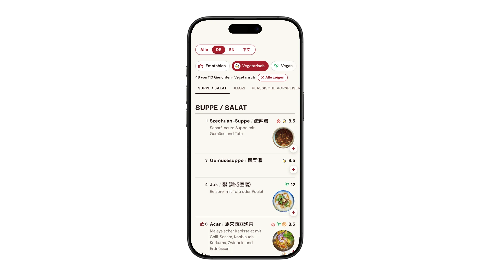

## What guests get

- The menu in German, English and Chinese, all at once or one language at a time. The choice is remembered.
- Filters for vegetarian, vegan, gluten-free, lactose-free, spicy and not spicy, plus the dishes the restaurant recommends.
- A photo next to each dish, large with one tap.
- A page that reads well on a phone, and that search engines can read too: the menu is real text, not a PDF or a picture, and each dish is also marked up for search engines, with its names in three languages, its price and its diet marks.

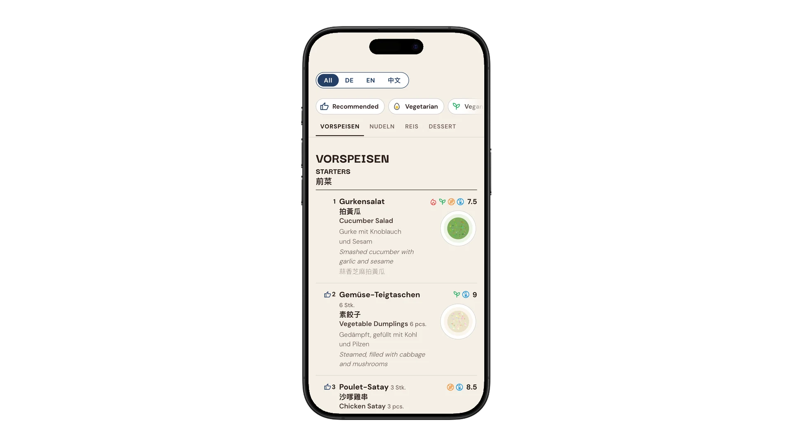

## What the owner does

- Upload the menu spreadsheet, as Excel or CSV. A short report says what was read, and warns about anything odd, like the same dish listed twice with different diet marks, or one dish number used twice.
- A file that is not a menu is refused, so the live menu never breaks. The last five uploads can be put back with one click.
- Download the live menu back as a CSV, with the same columns they uploaded: change it in Excel or Numbers and upload it again, or open it in [menuGen](/projects/menugen/) to print it.
- Upload all dish photos at once. A check list shows every dish with its photo, and which ones are still missing.
- Print QR table cards or a poster straight from the dashboard, with the Wi-Fi on them if they like. With the Statistics add-on, scans of the card are counted apart from visits where the address was typed in.
- Fill in where the meat and fish come from, as Swiss rules require in writing. It is translated into the menu languages and shown under the menu.
- Show the recommended dishes, with their photos, on any page, such as the home page. Each one links to the menu. They can be split into groups, like meat and fish or vegan and vegetarian.
- Leave the menu in the website’s own colours and fonts, or pick their own, and their own diet icons if they want, so the menu looks like their restaurant. A filter button only appears when a dish has that mark, and any of them can be hidden.
- Use the dashboard in German, English or Chinese. It follows each user’s WordPress language.
- Update MenuDash with one click, like any other plugin, when a new version comes out.

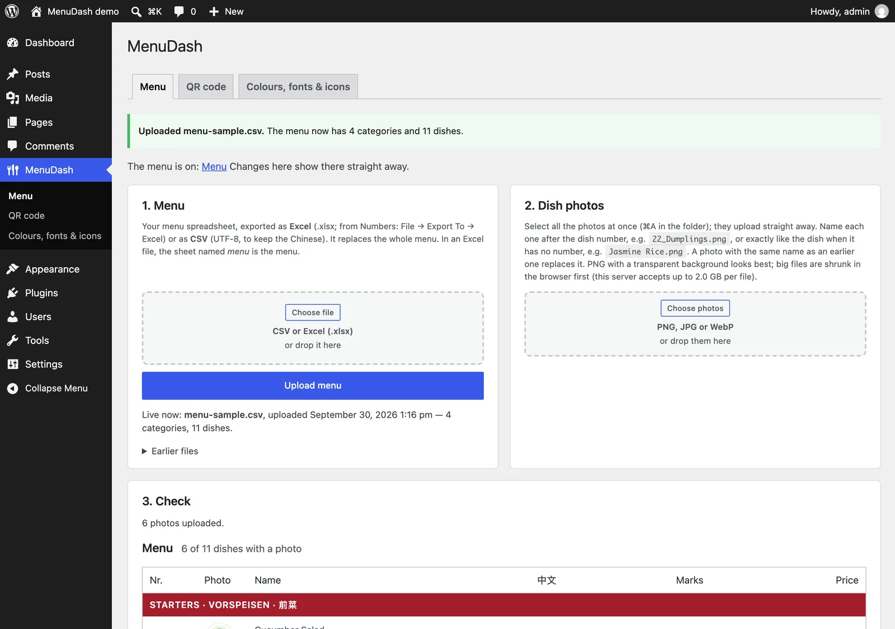

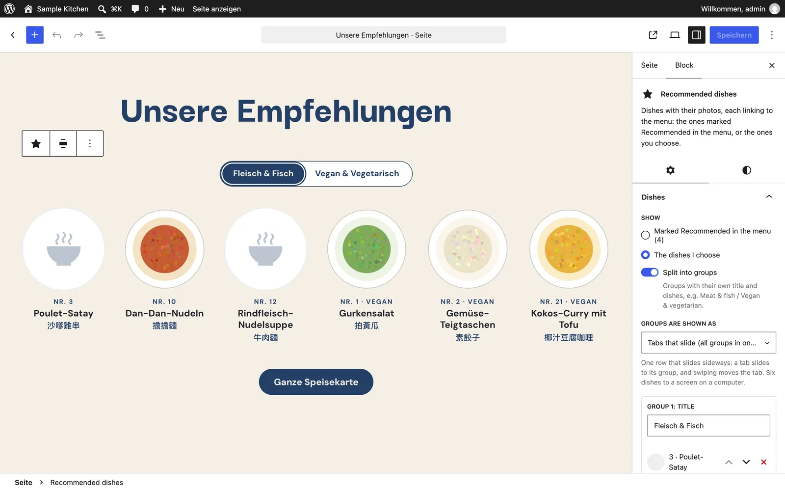

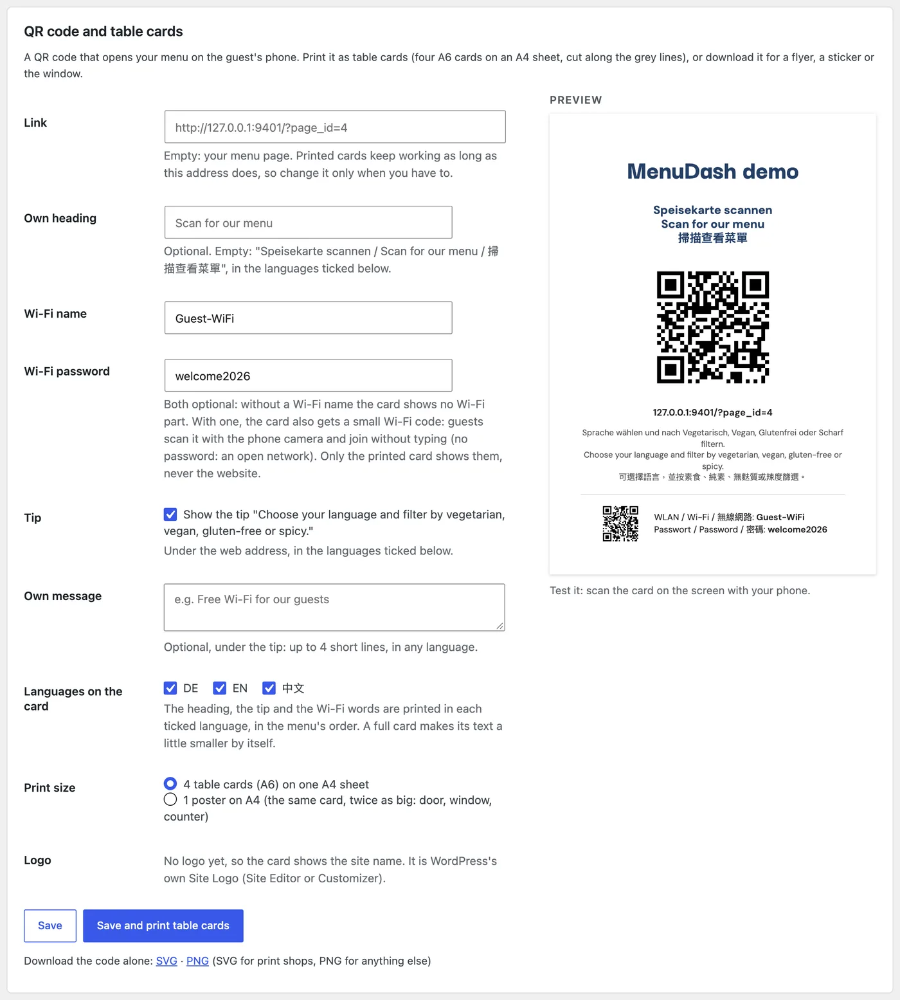

*Dashboard screenshots show the sample menu that ships with MenuDash.*

## Add-ons

MenuDash covers the menu. Four add-ons keep the rest of what guests look up on a restaurant website current, from the same dashboard page, which is in German, English or Chinese too.

### Restaurant

Address, phone, logo, delivery and reservation links, entered once. Opening hours with an “open now” badge, and a holiday notice that appears and disappears by itself. Links to Instagram, Facebook, TikTok, YouTube and WhatsApp, and to the restaurant’s Google and Tripadvisor reviews. A ready-made “Visit us” page with the address, the way there and the opening hours.

It also looks after what Google and chat apps show of the website. Search engines get the restaurant’s address, phone and opening hours as data, linked to its menu. Each page gets a short description, and a link shared on WhatsApp or Facebook shows a picture, on the menu page made from the recommended dishes. No SEO plugin needed; if the site already has one, MenuDash leaves it in charge.

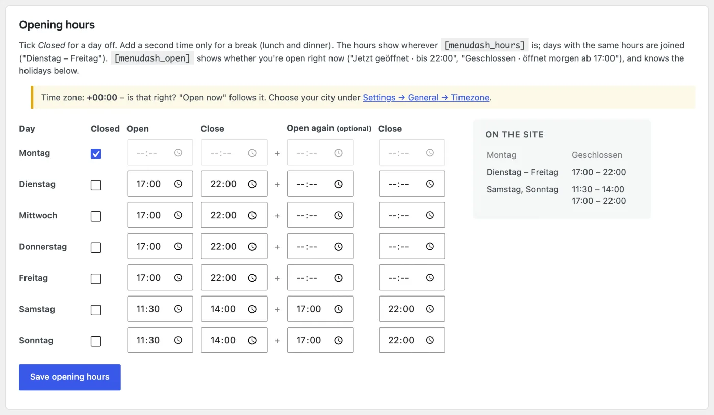

### Specials

Today’s specials and the lunch menu of the week, in the same style and languages as the menu. Each comes from its own short spreadsheet, or from its own sheet in the menu’s Excel file. The lunch menu shows today, with the whole week one tap away.

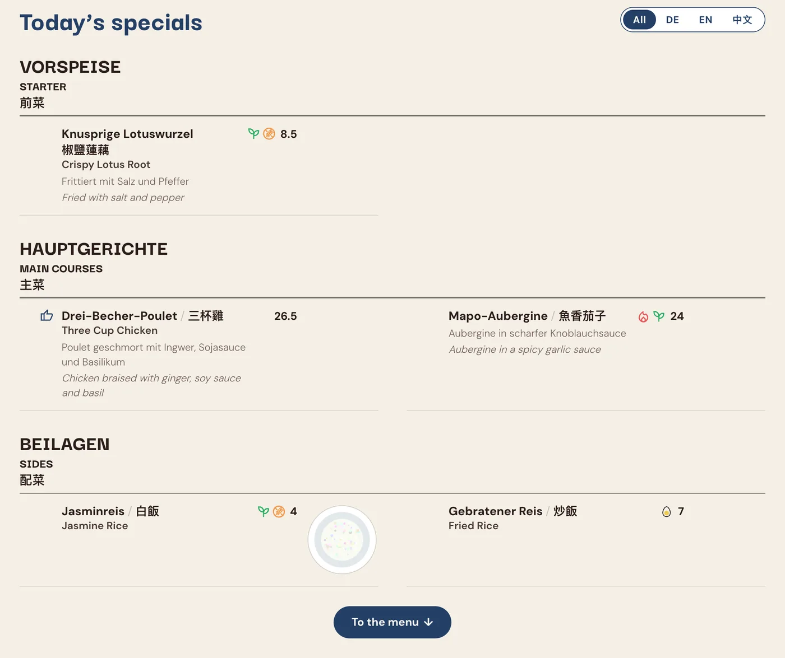

### Gift Cards

A gift card order form in the website’s language. The order arrives by e-mail with the restaurant’s logo; a switch pauses it, and spam is kept out.

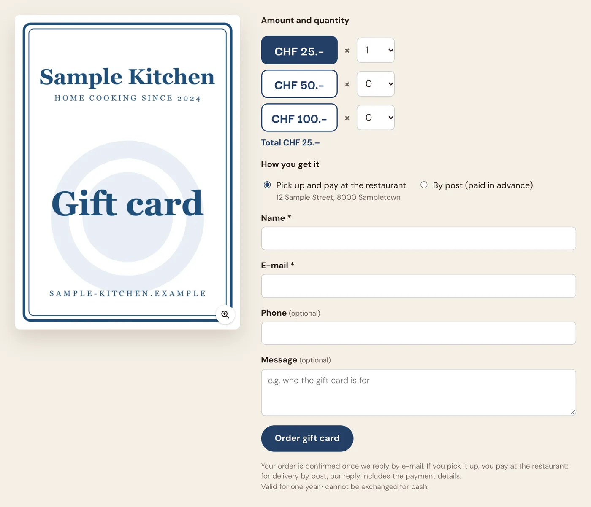

### Statistics

What guests do on the website, counted without watching anyone. The owner sees which dishes guests stop at (a dish counts when it stays on the screen for two seconds, not when it is scrolled past), whose photo they open, which categories they jump to, which diet filters they turn on and which language they switch to, over the last week, month or year. Dishes that are often looked at but whose photo is rarely opened are pointed out, so the owner can decide whether the photo needs to change. The counts stay with each dish when a new menu is uploaded.

It also shows where menu visits come from (the QR code on the table, search engines, the restaurant’s own website or elsewhere), what guests do next (call, open the way in Google Maps, order, book a table, order a gift card) and how fast the menu opens on their phones. Charts show it day by day, and any period can be downloaded as a spreadsheet.

**Before and after.** The owner marks the day something changed, such as new photos, a new menu or a new website, and sees the weeks after it next to the same number of weeks before. Too few counts to compare are labelled as such, not shown as a big jump.

*Sample numbers.*

**Built for privacy first.** No cookies. Nothing is stored in the guest’s browser and no IP address is saved; MenuDash keeps only the totals per dish, button and day, for at most 25 months. Where a visit comes from is sent only as its kind, never the address it came from, and the speed only as fast, medium or slow. To keep out fake counts, a scrambled form of the visitor’s address is held for ten minutes and deleted within a day at the latest, made with a key that changes every day, so nothing that is kept points to anyone. Guests whose browser asks not to be tracked are not counted at all, and neither are the owner and staff while logged in. A paragraph for the privacy policy comes with it, ready to copy.

## MenuDash Theme

A full restaurant website around MenuDash: a home page with the recommended dishes, opening hours and a map, the lunch menu and specials above the menu, links to the restaurant’s social media and reviews, and a Call · Directions · Menu bar on phones. The address and hours are typed once, in MenuDash, and every page shows them.

The theme works with MenuDash alone, and fills in more as add-ons are added. It is in German, English and Chinese; with the free Polylang plugin, each page can have its own version in every language, with a language switch in the header.

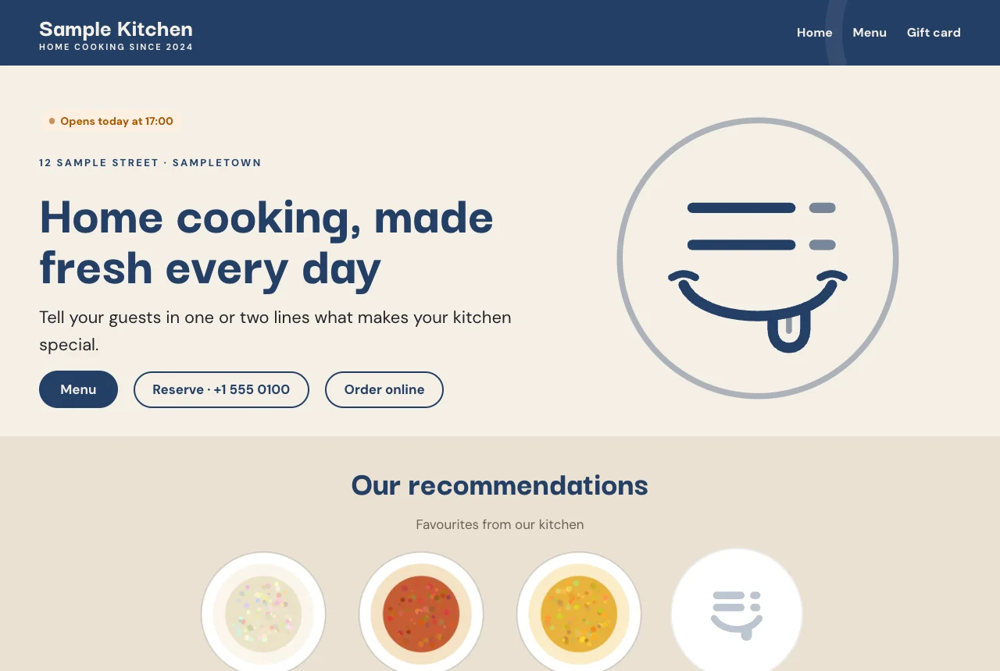

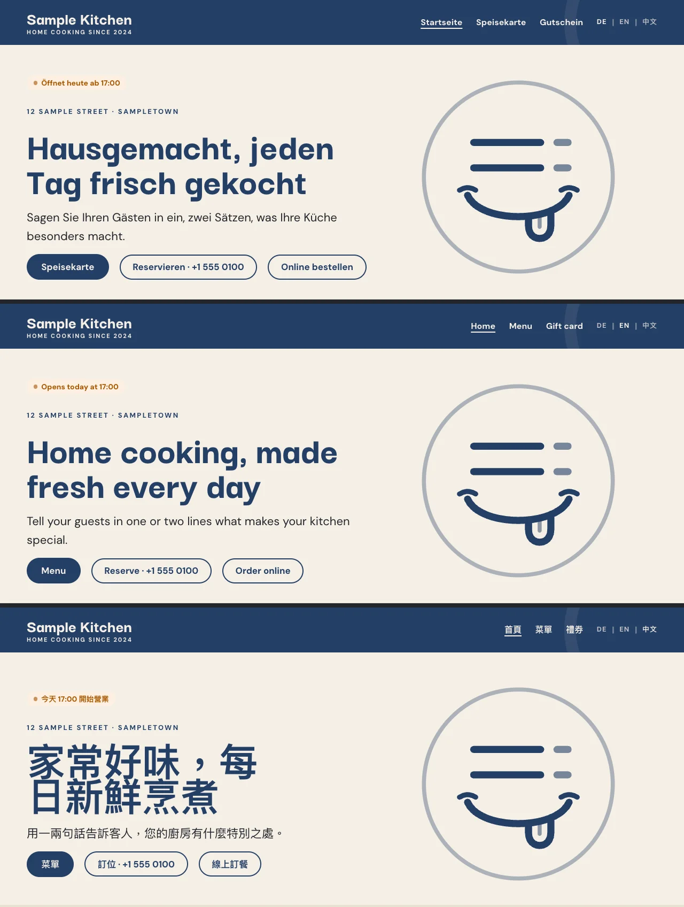

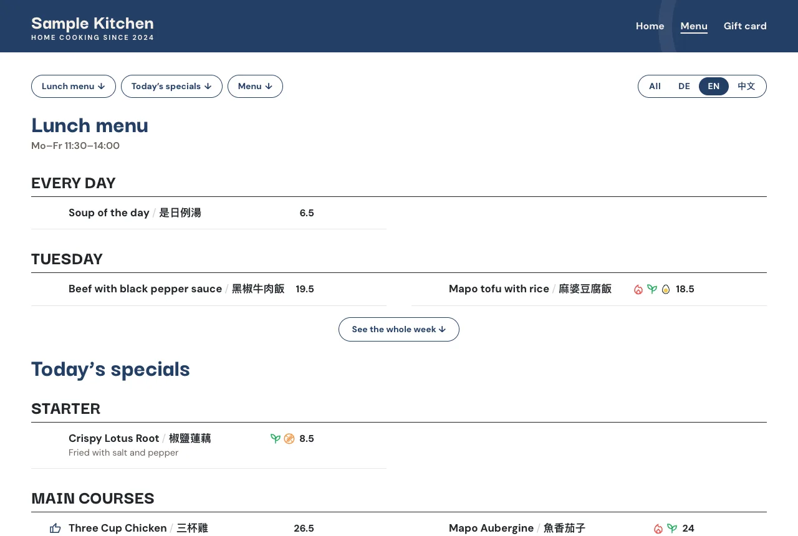

*Theme screenshots show its sample restaurant.*

## Packages

We set MenuDash up for restaurants. Each package is a one-time setup; the add-ons come with a yearly fee, which pays for their updates, installed by us, and for help when something changes. MenuDash itself updates from the WordPress dashboard.

| Package | What’s in it | Fees |
|---|---|---|
| **Menu** | MenuDash: the menu, photos, filters, QR cards and colours | One-time setup. Care plan optional. |
| **Menu + Restaurant** | MenuDash with the Restaurant add-on | One-time setup, plus a yearly fee |
| **Menu + Gift Cards** | MenuDash with the Gift Cards add-on | One-time setup, plus a yearly fee |
| **Complete** | MenuDash with Restaurant, Specials, Gift Cards and Statistics | One-time setup, plus a yearly fee |
| **Complete + website** | Everything above, on the MenuDash Theme or on a design made for the restaurant | One-time setup, plus a yearly fee |

Add-ons can be added to any package later. Every package is a fixed price, agreed in writing before we start.

**Opening a restaurant or café?** Two packages start from nothing: a website on the MenuDash Theme with the menu and the Restaurant add-on, the Google Business Profile, a domain and e-mail, drafts of the Impressum and privacy policy, and QR table cards. The larger one adds Specials, Gift Cards, Statistics, the meat origin and allergy note, a gift card design and an hour of training.

**Also on request:** a theme designed for the restaurant, like afatt.ch’s own; a monthly care plan with WordPress updates, backups and monitoring, and hours for changes; and print design for gift cards, flyers or a printed menu.

For prices, write to us with your current menu and your website address. We send the price list and a written estimate for your restaurant.

**How setup works.** We agree the package and the price. The restaurant sends its current menu, dish photos, logo, address and opening hours, and a login to its WordPress site; no site yet, and we set one up. We install it, put the menu into the spreadsheet, fill everything in and check every dish against its photo before anything goes live. The owner gets a short guide with a screenshot for each thing they will do: a new menu, new hours, a holiday.

## Open source, so you are not locked in

MenuDash and the MenuDash Theme are open source, on GitHub for anyone to see ([MenuDash](https://github.com/yingshiuan/menudash), [MenuDash Theme](https://github.com/yingshiuan/menudash-theme)). Your menu never depends on us: if you stop working with us, it keeps running. What you pay us for is the setup, the add-ons, and someone who answers when something needs to change.

**Good to know:**

- It runs on WordPress. A site on Wix or Squarespace does not fit, and we will say so.
- German, English and Chinese are built in. Other languages are possible, but they are extra work.
- One menu per site.
- It is the menu guests read. Recipes, food cost and stock belong to kitchen software, and MenuDash does not do them.

