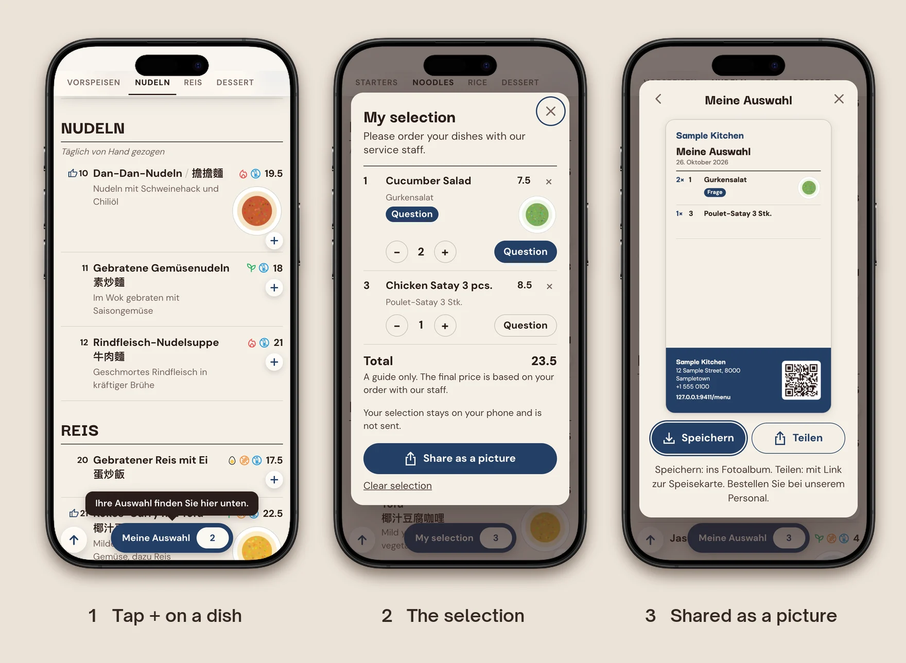

## Change a price once. Your website menu is right.

Most restaurants keep their menu in a file they edit, and the website menu is a copy of it: a PDF, a picture, or a page someone typed in by hand. Every price change means updating it twice, and the website is the copy that falls behind.

MenuDash makes your menu spreadsheet the website menu. You upload the file, and the menu page updates by itself: in German, English and Chinese, with photos and diet filters, on every guest’s phone. [See it running on afatt.ch](https://afatt.ch/menu/).

## What changes for you

- **One file for every menu.** A new price, a new dish, a dish that’s gone: change it once in Excel and upload it. The same file also goes into [menuGen](/projects/menugen/), our tool for printed menus, so the print PDF is current too.
- **Every guest finds their menu.** One QR code on the table. Each guest picks their language and filters for vegetarian, vegan, gluten-free, lactose-free or spicy on their own phone, instead of you keeping a separate menu for each.
- **A wrong file never breaks the page.** Every upload gets a short report. A file that isn’t a menu is refused and the live menu stays online, and the last five uploads can be put back with one click.
- **Guests order knowing what they want.** They put dishes on a selection while they browse and show it to your staff. [More below](#your-staff-still-take-the-order).

Also in MenuDash: the note on where the meat and fish come from that Swiss rules require, translated into the menu languages; a block of recommended dishes for the home page; your own colours, fonts and diet icons; and all dish photos uploaded at once, with a list of the ones still missing.

## Your staff still take the order

A busy room and two languages are where orders go wrong. Most QR menus fix that by letting the guest order from the menu on their phone. MenuDash does the opposite: the phone helps the guest talk to your staff.

- **Nothing to remember.** Guests tap + on the dishes they want while they browse.
- **Easy for your staff to read.** Each dish shows its number and its German name under the guest’s language, so the guest shows it instead of pronouncing it, and both can check the order against it.
- **A question starts a conversation.** A guest can mark a dish with a question for your staff.
- **Shared as a picture.** With your address and a QR code to your menu: for the group chat before a dinner, or sent to you with a takeaway order. It carries no prices, because prices change.
- **Nothing is ordered online.** A person still takes the order. You switch it on in the dashboard.
- **Your guests’ privacy stays on their phone.** The selection is kept on the guest’s phone only, gone when they close the page, with no account, no name and no phone number. The picture is made on the phone and goes only to whoever the guest sends it to. With the Statistics add-on, your site counts how often each dish is chosen, as a daily total, never anyone’s selection.

## How it works

1. **We set it up.** You send us your current menu, dish photos, logo, address and opening hours, and a login to your WordPress site; no site yet, and we set one up. We put the menu into the spreadsheet, fill everything in and check every dish against its photo before anything goes live.
2. **You upload.** When something changes, you change the spreadsheet and upload it on the MenuDash page in your WordPress dashboard, in German, English or Chinese. A short guide shows each step with a screenshot: a new menu, new hours, a holiday.
3. **Guests scan.** You print the QR table cards straight from the dashboard, with your Wi-Fi on them if you like. Guests scan, and the menu opens on their phone.

## Running at A Fatt

A Fatt, a Malaysian Chinese restaurant in Zürich, kept an English, a German and a vegan and vegetarian menu as PDFs, each behind its own QR code. One price change meant three edits. Now one QR code on the table opens one online menu: 110 dishes in three languages, with photos and diet marks. The owner uploads the menu herself, today’s specials sit above it, and the Statistics add-on counts which dishes guests look at. [See the menu on afatt.ch](https://afatt.ch/menu/).

## Add-ons

MenuDash covers the menu. Five add-ons keep the rest of what guests look up current, from the same dashboard page. Add one when you need it; Shop needs Restaurant, and the others work on their own.

### Restaurant

Address, phone, links and opening hours, entered once, with an “open now” badge. A notice for a holiday or a temporary closure appears and disappears by itself. Search engines and chat apps get the details and a share picture, with no SEO plugin needed.

### Specials

Today’s specials and the lunch menu of the week, in the same style and languages as the menu, each from its own short spreadsheet.

### Gift Cards

A gift card order form in the website’s language. Orders arrive by e-mail with your logo, and spam is kept out.

### Shop

A page for things guests take home: a jar of the house chili oil, cookies, or chairs you no longer need. Each item has photos, a price, how many are left and whether it is available, reserved or sold. Guests call or write and pick up at the restaurant; there is no cart and no online payment. Shop works together with the Restaurant add-on.

### Statistics

Which dishes guests stop at, which filters and languages they use, which dishes they choose for their selection, where menu visits come from, including from a shared selection, and what they do next: call, find the way, order, book. Mark the day something changed, such as new photos or a new menu, and see the weeks after it next to the weeks before. No cookies.

*Add-on screenshots show sample content.*

## Packages

We set MenuDash up for restaurants. Each package is a one-time installation; the add-ons come with a yearly maintenance fee, which pays for their updates, installed by us, and for help by e-mail when something changes. The first year is paid with the installation. MenuDash itself is free and updates from the WordPress dashboard.

**For a website you already have**

| Package | What’s in it | Fees |
|---|---|---|
| **Menu** | MenuDash: the menu, photos, filters, diet icons, colours, QR table cards and the guest’s selection | Installation only |
| **Menu + Restaurant** | The menu, with address, logo, opening hours, holidays and the “open now” badge | Installation, plus a yearly fee |
| **Menu + Gift Cards** | The menu, with gift card orders by e-mail | Installation, plus a yearly fee |
| **Complete** | The menu and all five add-ons: Restaurant, Specials, Gift Cards, Shop and Statistics | Installation, plus a yearly fee |

**Ready-made combinations:** Menu + Restaurant with Specials for a lunch restaurant, with Shop for take-home items, with Gift Cards, or with Statistics to know your guests. Any add-on can also be added to any package later.

**Opening a restaurant or café?** Two packages start from nothing. *Café Start*: a website on the MenuDash Theme with the menu and the Restaurant add-on, the Google Business Profile, a domain and e-mail, drafts of the Impressum and privacy policy, and QR table cards. *Restaurant Opening* adds Specials, Gift Cards, the meat origin and allergen page, a gift card design and an hour of training.

## Your website: the MenuDash Theme or your own design

MenuDash fits into the website you have. If you want the whole site to work with it, there are two ways.

**The MenuDash Theme.** A complete restaurant website, ready to fill in: a home page with the recommended dishes, opening hours and a map, the specials above the menu, and a Call · Directions · Menu bar on phones. Your logo, colours, pages and photos go in. It comes with the Complete package, or on its own for a site that already runs MenuDash.

**A theme designed for your restaurant.** Your own design, built on MenuDash, like the theme we made for A Fatt. On top of any package, with a fixed quote first, and looked after with a monthly care plan.

Either way, the address and hours are typed once, in MenuDash, and every page shows them, filling in more as add-ons are added.

## Care plans and extras

**Care plans** are monthly and optional, except with a custom theme. *Basic*: WordPress, theme and plugin updates, daily backups and uptime monitoring. *Standard* adds security monitoring and an hour of content changes. *Premium* adds three hours of changes and a reply within one working day.

**Also on request:** setting up or tidying your Google Business Profile; domain, hosting and e-mail with a Swiss provider; drafts of the Impressum and privacy policy; the meat origin list and allergy note in German, English and Chinese; and print design for gift cards, flyers or a printed menu.

For prices, write to us with your current menu and your website address. We send the price list and a written estimate for your restaurant. Every package is a fixed price, agreed in writing before we start.

## Good to know

- **You are not locked in.** MenuDash and the MenuDash Theme are open source, on GitHub for anyone to see ([MenuDash](https://github.com/yingshiuan/menudash), [MenuDash Theme](https://github.com/yingshiuan/menudash-theme)). If you stop working with us, your menu keeps running. What you pay us for is the setup, the add-ons, and someone who answers when something needs to change.
- **Search engines read every dish.** The menu is real text, not a PDF or a picture, and each dish is marked up with its names in three languages, its price and its diet marks.
- **Statistics counts without watching anyone.** No cookies, nothing stored in the guest’s browser and no IP address saved: only totals per dish, button and day, kept for at most 25 months. A paragraph for your privacy policy comes with it.
- **It runs on WordPress.** A site on Wix or Squarespace does not fit, and we will say so.
- **German, English and Chinese are built in.** Other languages are possible, but they are extra work.
- **One menu per site.**
- **It is the menu guests read.** Recipes, food cost and stock belong to kitchen software, and MenuDash does not do them.

